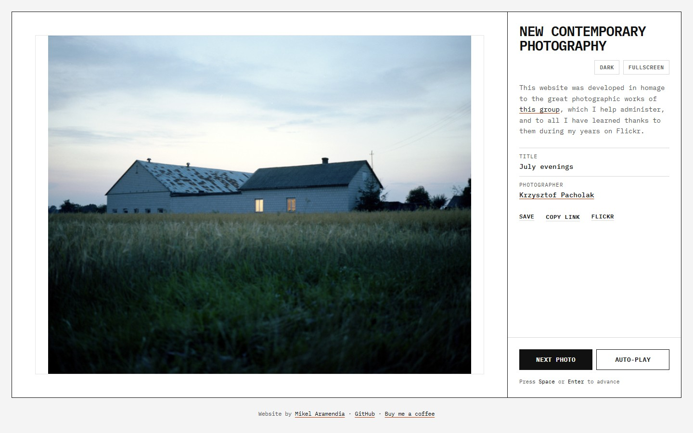

# New Contemporary Photography

[](https://new-contemporary-photography.vercel.app/)
[](https://developer.mozilla.org/docs/Web/JavaScript)
[](https://www.flickr.com/services/api/)
[](LICENSE)

A quiet photography showcase for the [New Contemporary Photography](https://www.flickr.com/groups/newcontemporaryphotography/) Flickr group. One photograph at a time, framed by typography rather than decoration.

[](https://new-contemporary-photography.vercel.app/)

## About

The site pulls a random photograph from the group pool and presents it on a white passe-partout. On desktop, the photograph fills the viewport while the metadata lives in a sidebar; on mobile, the same content becomes a single, readable column.

Every photograph has a permalink (`?photo=ID`), so a shared link opens that exact image instead of another random one. Photographer credit, the original Flickr page, and save/copy actions are always one click away.

## Features

- **Desktop viewer** — photograph stage plus a metadata sidebar, sized to the viewport with no page scrolling for portrait or landscape images.
- **Mobile-first layout** — a single column that keeps the photograph, credit, and controls readable on small screens.
- **Photo permalinks** — `?photo=ID` URLs that can be shared, bookmarked, and reopened.
- **Auto-play** — cycles through the pool every 10 seconds.
- **Fullscreen mode** — a distraction-free view of the current photograph.
- **Light and dark themes** — follows the system preference by default, remembers the visitor's choice.
- **Copy and save** — copy the site permalink or download the current image, with a visible Flickr credit.
- **GA4 events** — photo views, next/autoplay, saves, link copies, Flickr clicks, theme and fullscreen changes.
- **Accessible by default** — keyboard navigation (`Space` / `Enter`), visible focus states, `aria-live` metadata, and reduced-motion support.

## Design Principles

- **Photography first.** The image sits on a constant white passe-partout; the interface stays quiet around it.
- **Typography over decoration.** IBM Plex Mono carries the hierarchy through size, weight, and whitespace.
- **One accent.** Safety orange in light mode, electric blue in dark mode, used only for focus, hover, and link underlines.
- **Silence by default.** Flat surfaces, 1px rules, generous whitespace. Motion is used only where it explains a change.

## Getting Started

### Prerequisites

- [Node.js](https://nodejs.org/) 20.19+ (uses `--env-file-if-exists`)
- A [Flickr API key](https://www.flickr.com/services/apps/create/apply/)
- The Flickr group ID: `1023374@N21`

### Local development

1. **Clone the repository**

   ```bash
   git clone https://github.com/Mendiak/new-contemporary-photography.git
   cd new-contemporary-photography
   ```

2. **Configure your credentials**

   Create `.env.local` in the project root:

   ```dotenv
   NEXT_PUBLIC_FLICKR_API_KEY=YOUR_KEY_HERE
   NEXT_PUBLIC_FLICKR_GROUP_ID=1023374@N21
   ```

3. **Install and run**

   ```bash
   npm install
   npm run dev
   ```

   The dev script generates `public/config.js` from `.env.local` and serves the site at [http://localhost:3000](http://localhost:3000).

### Available scripts

| Script | Description |
| --- | --- |
| `npm run dev` | Generate `public/config.js` and start the local server on port 3000 |
| `npm run config` | Generate `public/config.js` only |
| `npm start` | Alias for `npm run dev` |

> The project has no runtime dependencies: the local server (`dev-server.js`) and the config generator use only Node.js built-ins.

## Project Structure

```text
.
├── public/
│   ├── index.html        # Markup, metadata and structured data
│   ├── styles.css        # Design tokens, viewer grid and responsive rules
│   ├── script.js         # Flickr API, viewer, permalinks and GA4 events
│   ├── robots.txt
│   ├── sitemap.xml
│   ├── favicon.png
│   └── assets/
│       └── screenshot.jpg
├── assets/screenshot.jpg # Screenshot used by the README
├── dev-server.js         # Zero-dependency local static server
└── generate-config.js    # Writes public/config.js from environment variables
```

## Deployment

The site is deployed on [Vercel](https://vercel.com/) and serves the `public` directory as a static site.

Set these environment variables in the Vercel project:

```text
NEXT_PUBLIC_FLICKR_API_KEY
NEXT_PUBLIC_FLICKR_GROUP_ID
```

The build step runs `node generate-config.js`, which writes the credentials to `public/config.js` before deployment.

## Analytics and SEO

- **Google Analytics 4** (`G-EDG153PWJP`) receives custom events for the viewer interactions listed above.
- **Search Console** can verify the site through the existing meta tag.
- `public/robots.txt` and `public/sitemap.xml` are included for crawlers.
- Each photograph is shareable through its `?photo=ID` permalink; the canonical URL remains the site root.

## Dedication

> "Web desarrollada en homenaje a los grandes trabajos fotográficos de este grupo y a todo lo aprendido gracias a ellos en mis años en Flickr."

A personal tribute to the photographers who inspired my journey.

## Credits

Designed and maintained by [Mikel Aramendia](https://mendiak.github.io/portfolio/), group admin. Photographs belong to their respective authors and are linked back to their original Flickr pages.

If you enjoy the project, you can [buy me a coffee](https://buymeacoffee.com/Mendiak).
